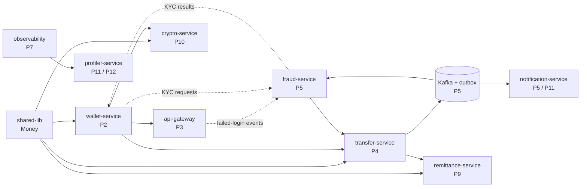

# CloudPay roadmap — build order and service dependencies

> The master map for development order. Each service's own `CLAUDE.md` says *how* to work on it; this file says *when* and *what it waits on*.
> Phase numbers P1-P14 are the project's phase plan (order fixed, dates flexible). Started 2026-05-17.

---

## 1. Dependency graph

Arrows read "is needed by". A service can't get past its stub until everything pointing at it is on `master`.

`F --> T` is real: once fraud exists, the transfer saga waits on its decision. Transfer is built first (P4) with the fraud step left out; P5 adds it.

Dotted edges are P5 event flows between services that already exist by then; they don't change the build order, but their topics and schemas belong to G5.

---

## 2. Build order

| # | Work | Phase | Waits on (must be on `master`) | Contract gate (agree in thinking chat first) |
|---|---|---|---|---|
| 0 | Phase 1 leftovers: AWS seed, `v0.1.0-skeleton` tag | P1 | — | — |
| 0b | GitHub repo controls + security scanning (S4): branch protection on `master`, required checks, CODEOWNERS, GitHub Actions build + test, Dependabot, CodeQL, secret scanning with push protection | P2 | repo on GitHub | — |
| 1 | `shared-lib`: `Money` | P2 | — | **G1** currency representation (fiat, crypto, gold XAU) |
| 2 | `wallet-service`: domain, Liquibase, `@Version`, light CQRS | P2 | #1 for domain code (skeleton can start earlier) | — |
| 3 | `wallet-service`: idempotency keys on credit/debit, Redis cache, query/index tuning with before/after numbers | P2 end | #2 | **G2** idempotency-key semantics (header, TTL, replay response) |
| 4 | `api-gateway`: routing, JWT validation, rate limiting, login lockout, device binding, step-up auth | P3 | #2 (needs a route target) | **G3** JWT claims, user id → `ownerId`; auth server inside gateway or separate |
| 5 | `transfer-service`: aggregate, saga (no fraud step), Resilience4j to wallet | P4 | #3 | **G4** wallet credit/debit API used by transfer; saga style (orchestration vs choreography) |
| 6 | Kafka infra + outbox in `transfer-service` | P5 | #5 | **G5** event schemas (Avro), topic names, Schema Registry port |
| 7 | `fraud-service`: consumer, velocity + blacklist checks, async KYC checks (request/result/error topics) | P5 | #6 | **G6** how the fraud decision reaches the saga (event vs sync call) |
| 7b | `notification-service` (Quarkus): consumer, hash-chained audit log, async receipts, external accounting sync | P5 | #6 | — (consumes G5 events) |
| 7c | `transfer-service`: reconciliation job (transfers vs wallet ledger), daily summary report | P5 | #6 | — |
| 7d | `wallet-service`: KYC onboarding (wallet starts `PENDING_KYC`, becomes `ACTIVE` on a KYC-approved event) | P5 | #7 (KYC topics live) | — (KYC topics and schemas are part of G5) |
| 8 | AWS EKS + ElastiCache (S3), Terraform, Argo CD, CI/CD with image scanning (Trivy) | P6 | #2-#7 have Dockerfiles | — |
| 8a | AWS IAM + Secrets Manager + KMS (S1): least-privilege IAM roles per service (IRSA), secrets from Secrets Manager (no secrets in env or compose), KMS for encryption at rest and envelope encryption of sensitive wallet/KYC fields | P6 | #8 | **G9** which fields get field-level encryption, key ownership per service |
| 8b | Lambda + SNS/SQS (S2): `notification-service` publishes to SNS, one SQS queue per delivery channel (email, SMS, push), Lambda stub senders with DLQs. Kafka stays the internal event backbone | P6 | #7b, #8 | ADR: Kafka for domain events vs SNS/SQS for delivery fan-out |
| 9 | Observability: traces, metrics, SLOs, load tests (spike + soak) with before/after numbers | P7 | #8 | — |
| 10 | Service mesh: Istio, canary, chaos | P8 | #8, #9 | — |
| 10b | Security testing + remediation (S5): authz tests (IDOR on `ownerId`, JWT tampering, rate-limit bypass), OWASP ZAP scan against the gateway, fix CodeQL/Dependabot/Trivy findings, log each fix in `docs/security/` | P8 | #0b, #8a | — |
| 11 | `remittance-service`: provider registry, DB corridor rules, FX quotes, parallel provider calls, quote ranking | P9 | #1, #5 | **G7** FX quote contract and how transfer uses it |
| 12 | `crypto-service`: asset-provider layer (crypto + gold), buy/sell, quote TTL, price stream | P10 | #1 (crypto scale), #3, #6 | **G8** crypto ↔ wallet settlement (fiat debit + crypto credit, compensation) |
| 13 | Spring AI: fraud scoring, notification RAG, compliance report, crypto insight | P11 | #7, #7b, #12 | — |
| 14 | `profiler-service` (start P11, real build P12), memory-leak / GC investigation write-up | P11-P12 | #9 (needs metrics and running services) | — |
| 15 | DDD refactor (strangler-fig extraction behind the gateway), KEDA | P12 | all above | — |
| 16 | Portfolio, then interview | P13-P14 | — | — |

**Contract gates:** before the second side of a gate starts coding, the contract gets written in the thinking chat and committed as an ADR or a doc under `docs/architecture/`. Neither service session invents it.

---

## 3. What can run in parallel

At ~7 hrs/week, **keep at most 2 service sessions active at once**. Each switch between sessions costs re-reading context; a third one costs more than it gains.

Sensible pairs:

| Window | Session A | Session B |
|---|---|---|
| P2 | `shared-lib` (Money) | `wallet-service` skeleton: Liquibase, context-load test, no money code yet |
| P3 | `api-gateway` | `wallet-service` (idempotency, cache) |
| P5 | `fraud-service` | `notification-service`, once G5 events are on `master` |
| P9-P10 | `remittance-service` | `crypto-service`, if time allows; otherwise in order |

Don't pair two sessions that edit the same module, or one that changes a contract the other is consuming.

---

## 4. Known conflicts to resolve

These are inconsistencies across the docs. Each is also listed in the service file it affects.

| # | Conflict | Affects | Resolve by |
|---|---|---|---|
| 1 | Schema Registry and `remittance-service` both on host port 8085 | Kafka, remittance | G5 (P5) |
| 2 | Saga: CLAUDE.md §3 says orchestration; the older architecture says choreography | transfer | G4 (P4) |
| 3 | `fraud-service` needs DynamoDB in P5, but AWS SDK lands P6+ (§10) | fraud | Before P5: DynamoDB Local in compose, or start on Redis only |
| 4 | `notification-service` needs MongoDB in P5, but the compose comment said P10 | notification | Fixed 2026-11-15 (compose marker moved to P5) |
| 5 | Phase numbers: CLAUDE.md §3 used months; compose comments used other phase numbers | docs | Fixed 2026-11-15 |
| 6 | `Money` currency type: `java.util.Currency` can't represent crypto (gold XAU also needed) | shared-lib, crypto | G1 (P2) |
| 7 | Root pom forces Spring Boot BOM + `spring-boot-starter` on every module; `notification-service` is Quarkus | notification, root pom | Before P5 skeleton |
| 8 | RAG chat / compliance reports planned with Spring AI, but `notification-service` is Quarkus | notification | Before P11: Quarkus LangChain4j or move AI to a Spring service |
| 9 | External accounting sync (R20) sits in `notification-service`, which is about notifying users, not integrating ledgers | notification, transfer | Before P5: keep it there with a reason in the Quarkus ADR, or move it to `transfer-service` next to reconciliation |

---

## 5. Using this file

- At the start of each week: find the current row in §2, check its "waits on" column, then open that service's `CLAUDE.md`.
- When a gate is agreed: link its ADR in the table.
- When a row is done: mark it `done (YYYY-MM-DD)` in the Work column.
- Resume-linked items (R1-R21) and target-role skills (S1-S5) are tracked in `local/resume-map.md` (local only, not in the repo). Update its Status column when the item lands.
